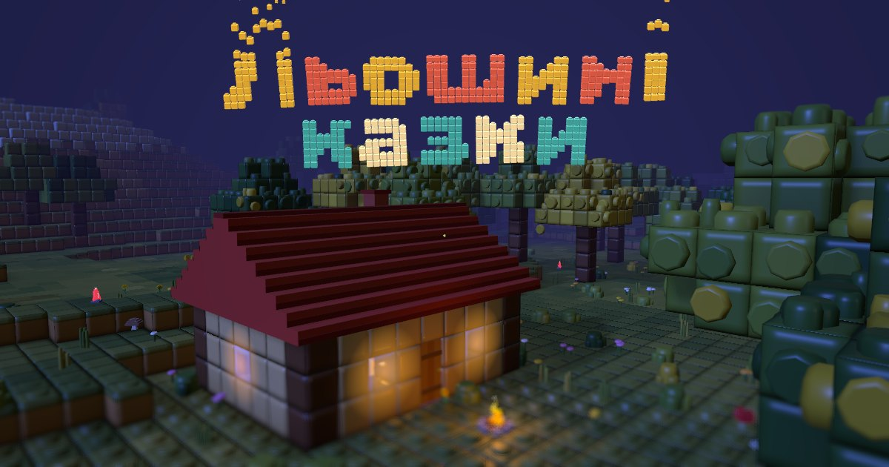
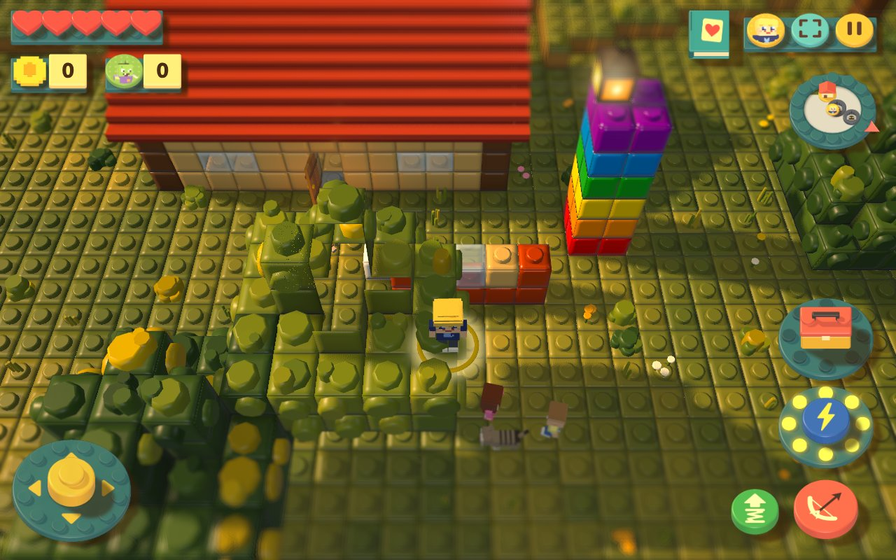
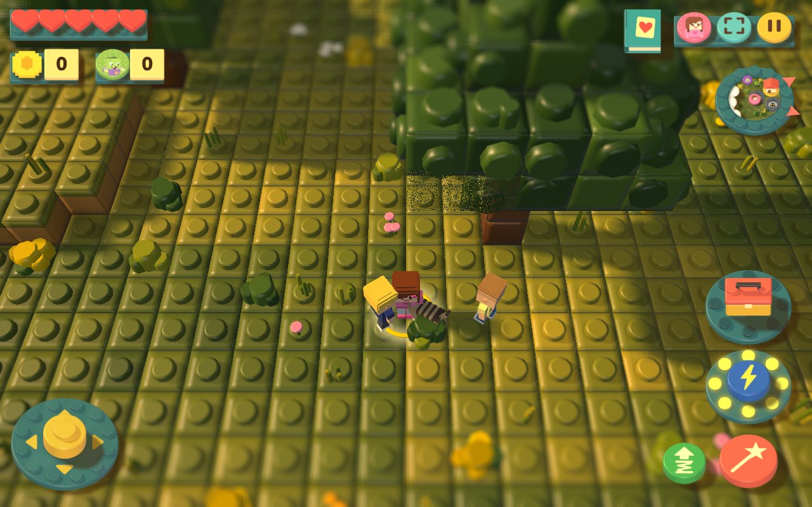
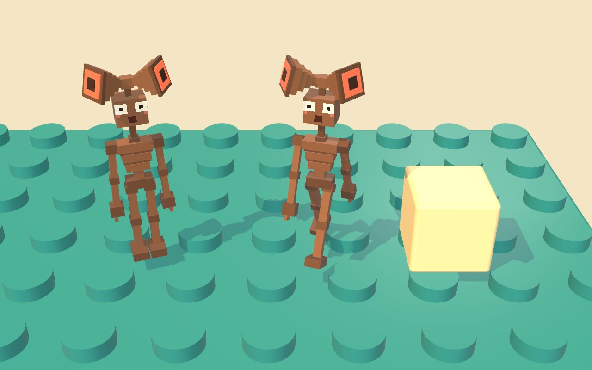

<p align="center">
  
</p>

<h1 align="center">Льошині казки</h1>

<p align="center">
  <b>A blocky 3D browser game whose stories are invented by a 6-year-old.</b><br>
  Ukrainian voice-over · offline PWA for an Android tablet · built with Claude Code
</p>

<p align="center">
  <a href="https://ikstro.com/koto-tales/"><b>▶ Play in the browser</b></a> ·
  <a href="#how-a-childs-wish-becomes-the-game">How wishes become the game</a> ·
  <a href="#working-with-claude-code">Claude Code setup</a>
</p>

<p align="center">
  <a href="https://github.com/ikstro/koto-tales/actions/workflows/deploy.yml"></a>
  <a href="https://github.com/ikstro/koto-tales/actions/workflows/ci.yml"></a>
  
  
</p>

---

Льоша (6) makes up the monsters, treasures and tales; his friends Соломія and Давид and the cat Пупся are
the other heroes. His parent retells each idea to Claude Code, and a fixed pipeline of skills turns it into
game content: a data card, a hand-built toy model, voice lines and a Ukrainian voice-over, with tests that
check nothing is missing.

| Home, daytime | The meadow |
| --- | --- |
|  |  |

<p align="center">
  <br>
  <sub>A monster from one of Льоша's wishes, as <code>npm run preview</code> renders it for him to approve.</sub>
</p>

## Rules of the game

- **No losing.** Home is always safe.
- **Nothing needs reading.** Icons, voice and numbers only.
- **A generic toy-brick look.** No brands, logos on studs or copies of real games.
- **One touch, one thing.** Every control answers at once with motion and sound.

The full design system lives in [DESIGN.md](DESIGN.md).

## Quick start

Requires Node.js 22+ (CI uses 24).

```bash
npm ci
npm run dev        # dev server on your LAN, open it on the tablet
npm run check      # typecheck + all tests (369 at the time of writing)
npm run build      # production build into dist/
```

Handy URL switches for development (full list in [`src/core/params.ts`](src/core/params.ts)):
`?autostart=1&hero=lyosha`, `?time=0.66&freeze=1` (evening), `?spawn=<monster>`, `?give=<card id>`, `?stats=1`.

| Script | What it does |
| --- | --- |
| `npm run dev` / `serve` | Dev server / serve the built `dist/` |
| `npm run check` | `tsc --noEmit` + Vitest, including the content registry check |
| `npm run new -- <kind> <id>` | Stubs for a new card: card, model file, lines |
| `npm run preview -- <kind> <id>` | Renders a picture of one model for review |
| `npm run voice` | `src/content/lines.json` → `public/voice/*.mp3` (Azure Speech, keys from env) |
| `npm run hud` | Bakes the 3D HUD sprites |
| `npm run shots` / `perf` | Tablet-size screenshots of fixed scenes / a performance run |

## Architecture

```
src/
  contracts.ts   the seams between modules, one file
  core/          game loop, camera, input, events bus, URL params
  world/         style-neutral world data: terrain, blocks, mesher, landmarks, villages
  render/skins/  the look as a swappable skin (default: «diorama»)
  assets/        models: code-built parts, .glb or a child's drawing, one rig convention
  content/       data cards: monsters, items, artifacts, buildings, companions, tales, lines
  systems/       gameplay systems; versioned saves with migrations
  ui/  voice/    HUD made of toy pieces, the voice-over player
tools/           voice generation, HUD baking, previews, screenshots, card stubs
wishes/          the log of Льоша's ideas, one file per wish
```

- **Content is data, not engine code.** A new monster is a card in `src/content/monsters.ts`, a model in
  `src/assets/parts/<id>.ts` and two lines. [CONTENT.md](CONTENT.md) is the vocabulary of what a card can do.
- **Systems talk through events** (`src/core/events.ts`), not through each other.
- **The content check is a test.** `src/content/registry.test.ts` fails if any card lacks its model, lines
  or (in the deploy) its mp3.
- **Every push to `main` is checked and deployed** to GitHub Pages; pull requests run the same checks.

## How a child's wish becomes the game

```
"Льоша хоче сиреноголового!"
      │
      ▼  /wish skill
wishes/2026-10-30-sirenhead.md      Льоша's words verbatim, split into kinds
      │
      ▼  /new-monster skill  →  npm run new -- monster sirenhead
card + model stub + line stubs
      │
      ├─ model-builder agent   builds the toy model by hand
      ├─ lines-writer agent    writes short spoken Ukrainian lines
      ▼
npm run preview  →  picture for Льоша and his parent to say yes
npm run voice    →  mp3 for every line
content-check agent / npm run check  →  green
      │
      ▼
merge to main  →  deployed to the tablet
```

## Working with Claude Code

The repository is set up so that any Claude Code session follows the same process.

| Where | What |
| --- | --- |
| [`CLAUDE.md`](CLAUDE.md) | Project brief, commands, architecture and hard rules; imports `DESIGN.md` and `CONTENT.md` |
| [`.claude/skills/wish`](.claude/skills/wish/SKILL.md) | Entry point: one wish → logged, split into kinds, routed to the skills below |
| [`.claude/skills/new-monster`](.claude/skills/new-monster/SKILL.md), [`new-item`](.claude/skills/new-item/SKILL.md), [`new-building`](.claude/skills/new-building/SKILL.md), [`new-companion`](.claude/skills/new-companion/SKILL.md), [`new-tale`](.claude/skills/new-tale/SKILL.md) | One skill per kind of content: which files to touch, defaults, real examples |
| [`.claude/agents/model-builder`](.claude/agents/model-builder.md) | Builds one toy-brick model from a plain description |
| [`.claude/agents/lines-writer`](.claude/agents/lines-writer.md) | Writes the voice lines in the game's voice |
| [`.claude/agents/content-check`](.claude/agents/content-check.md) | Runs the checks and reports what is still missing (runs on a small, cheap model) |
| [`docs/plans`](docs/plans) | Design notes for bigger changes |

The split is deliberate: skills hold the *process* (what to do for each kind of wish), agents do the narrow
repeated jobs, and tests, not the model, decide when a card is complete.

## Privacy

Photos of the children never go into the repository; working pictures stay in the git-ignored `design-lab/`.
Wishes keep only the child's words: no surnames, places or photos.

## License

The source code is under the [MIT License](LICENSE). The characters, stories, artwork and the generated
voice-over are © the author and are not covered by it.
